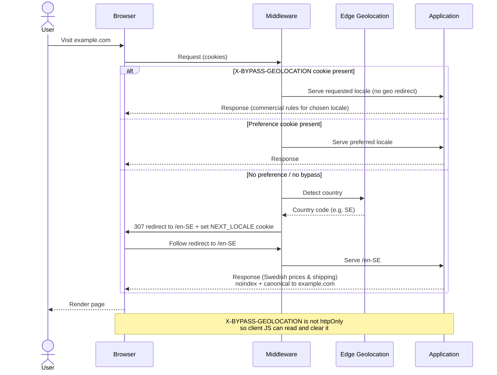

# International Blueprint

## Instructions for Implementing Locale Grouping and Indexing

This document describes how to structure a multilingual e-commerce platform so that search engines see a clean, non-duplicated set of pages while real users still receive the correct country-specific commercial experience (pricing, currency, shipping, availability).

---

## 1. Core Rules

1. **Every locale must include both a language and a country.**  
   Valid examples: `en-US`, `en-SE`, `sv-SE`, `fr-FR`, `en-FR`.  
   Language-only paths (such as `/sv` or `/en`) are not allowed.

2. **The root URL is the canonical English version.**  
   `example.com` represents the default locale (normally `en-US`) and is the only English URL that search engines should index for the collapsed English markets.

3. **Group content-identical markets.**  
   If several English locales (for example `en-SE`, `en-NO`, `en-GB`, `en-US`) contain the same products and the same textual content, they belong to one group. Only the group’s canonical version is indexed.

4. **Keep unique markets fully indexed.**  
   If a market has meaningfully different products, exclusive items, or substantially different content (for example France), it remains a first-class indexed locale with its own hreflang entry.  
   For these unique markets, set the HTML `lang` attribute to the full locale (e.g. `lang="en-FR"`) rather than the bare language (`lang="en"`). This matches BCP 47 and is consistent with how Google uses regional tags on market-specific pages.

5. **Never redirect search engine crawlers.**  
   Bots must always receive the default content at the root (or the appropriate indexed locale). Only human visitors are redirected into commercial locales.

6. **Commercial-only locales must not be indexed.**  
   URLs such as `/en-SE` and `/en-NO` exist only so the platform can apply the correct prices and shipping. They must be marked noindex and must point their canonical tag back to the indexed version of their group.

---

## 2. How Grouping Works

Define groups by language (or by language family when content is shared).

- **English group**  
  Canonical: `en-US` (served at the root `example.com`).  
  Members: `en-US`, `en-SE`, `en-NO`, `en-GB`, and any other English locale that shares identical content.  
  Exclusion: any English locale that must stay unique (for example `en-FR` if France has exclusive products).

- **Swedish group**  
  Canonical: `sv-SE`.  
  Members: `sv-SE` and any other Swedish locale that shares the same content (for example `sv-NO`).

- **French group**  
  Canonical: `fr-FR`.  
  Members: locales that share French content.  
  Any French market with different products is listed as unique instead of grouped.

Unique locales (those listed in the exclusion or unique list) are never collapsed. They receive their own indexed URLs and appear in the hreflang cluster.

---

## 3. TypeScript Schema Examples

The following TypeScript types and an example configuration illustrate the structure described above.

```ts
/** A locale is always language-country, e.g. "en-US", "sv-SE", "fr-FR" */
type Locale = `${string}-${string}`;

/** A language code without country, e.g. "en", "sv", "fr" */
type Language = string;

interface LocaleGroup {
  /** The single locale that is indexed and used as the canonical for the group */
  canonicalLocale: Locale;

  /** All locales that share identical content and belong to this group */
  members: Locale[];

  /** Locales that would otherwise match the language but must stay unique / fully indexed */
  exclude?: Locale[];
}

interface I18nConfig {
  /** The locale served at the root URL (example.com). Must be a member of the default language group. */
  defaultLocale: Locale;

  /** Supported languages */
  languages: Language[];

  /** Complete list of locales the platform can operate in */
  locales: Locale[];

  /**
   * Groups of content-identical locales.
   * Key is typically the language code.
   */
  groups: Record<Language, LocaleGroup>;
}
```

### Example configuration

```ts
const i18nConfig: I18nConfig = {
  defaultLocale: "en-US",

  languages: ["en", "sv", "fr"],

  locales: [
    "en-US",
    "en-SE",
    "en-NO",
    "en-GB",
    "en-FR",
    "sv-SE",
    "sv-NO",
    "fr-FR",
    "fr-BE",
    "fr-CA",
  ],

  groups: {
    en: {
      canonicalLocale: "en-US",
      members: ["en-US", "en-SE", "en-NO", "en-GB", "en-DE", "en-NL"],
      exclude: ["en-FR"], // France stays unique
    },
    sv: {
      canonicalLocale: "sv-SE",
      members: ["sv-SE", "sv-NO"],
    },
    fr: {
      canonicalLocale: "fr-FR",
      members: ["fr-FR"], // or add more if they share content
    },
  },
};
```

This configuration tells the system:

- Serve English content for the collapsed markets at the root.
- Index `/sv-SE` as the Swedish canonical.
- Keep `/en-FR` (excluded from the English group) and `/fr-FR` (group canonical) as independent indexed locales.
- Treat `/en-SE`, `/en-NO`, etc. as commercial-only (noindex + canonical to root).

### Flexible model (optional): any language applicable to any country

This is not a core rule. Many multilingual e-commerce stores, however, allow every language to be used with every country. In those cases the full set of locales can be generated automatically:

```ts
const countries = ["US", "SE", "NO", "GB", "FR", "DE", "NL", "BE", "CA"];
const languages = ["en", "sv", "fr"];

const locales = countries.flatMap((c) =>
  languages.map((l) => `${l}-${c}` as Locale),
);
// Result: ["en-US", "sv-US", "fr-US", "en-SE", "sv-SE", "fr-SE", ...]
```

Groups can then use wildcards so you do not have to list every member explicitly:

```ts
const i18nConfig: I18nConfig = {
  defaultLocale: "en-US",
  languages,
  locales,

  groups: {
    en: {
      canonicalLocale: "en-US",
      members: ["en-*"], // every English locale
      exclude: ["en-FR"], // France remains unique
    },
    sv: {
      canonicalLocale: "sv-SE",
      members: ["sv-*"], // every Swedish locale
    },
    fr: {
      canonicalLocale: "fr-FR",
      members: ["fr-*"], // every French locale
      exclude: ["fr-FR"], // optional: keep the canonical itself out of the wildcard if needed
    },
  },
};
```

### Deriving the indexable locales

Unique / indexable locales are derived automatically:

- Every locale listed in any group’s `exclude` array.
- Every locale that is not covered by any group’s `members` (after expanding wildcards).
- Plus each group’s `canonicalLocale`.

```ts
const indexableLocales = getIndexableLocales(i18nConfig);

// Example result for the configuration above:
// [
//   "en-US",   // root / English canonical
//   "sv-SE",   // Swedish canonical
//   "fr-FR",   // French canonical
//   "en-FR",   // excluded from the English group → unique
// ]
```

Everything else (`en-SE`, `sv-NO`, `fr-US`, etc.) is treated as commercial-only: available to users, but not indexed and canonicalized back to the appropriate group canonical.

---

## 4. What Search Engines See

Search engines are only shown the indexed versions:

- `example.com` (English canonical for the whole English group)
- `example.com/sv-SE` (primary Swedish)
- `example.com/fr-FR` (primary French)
- `example.com/en-FR` (unique English-France, if applicable)

Hreflang annotations are emitted only for these indexed URLs.  
Each indexed page lists itself, points `x-default` to the root, and links bidirectionally to the other indexed variants.  
Commercial-only locales (`/en-SE`, `/en-NO`, etc.) do not appear in any hreflang list.

---

## 5. What Real Users Experience

1. A visitor lands on `example.com` (or any indexed URL).
2. The platform detects the visitor’s country (via edge geolocation).
3. If the visitor has no previously chosen locale, they are redirected (307) into the commercial locale that matches their country (for example Sweden → `/en-SE`).
4. A cookie is set so subsequent requests stay in that locale.
5. The commercial locale page applies the correct currency, prices, shipping rules, and availability, but it is not indexed and its canonical points back to the indexed version of its group.

If the user manually switches language or country, that preference is stored and respected over automatic geo-routing.

**Geolocation bypass.**  
If a user explicitly wants to stay in a different market and not be redirected (for example, someone on vacation in the USA who still wants to order to their Norwegian address), a cookie named `X-BYPASS-GEOLOCATION` can be set. When this cookie is present, geo-based redirects are skipped. The cookie should have a 7-day lifetime.

This cookie must **not** be `httpOnly`. It needs to be readable by client-side JavaScript so the front end can detect the bypass state and offer a way to clear it (for example, a “switch market” or “resume geo-routing” control).

---

## 6. Indexing and Canonical Policy

| URL pattern              | Indexed? | Canonical points to  | Purpose                                           |
| ------------------------ | -------- | -------------------- | ------------------------------------------------- |
| `example.com`            | Yes      | itself               | English content for all collapsed English markets |
| `/sv-SE`                 | Yes      | itself               | Primary Swedish version                           |
| `/fr-FR`                 | Yes      | itself               | Primary French version                            |
| `/en-FR` (unique)        | Yes      | itself               | Distinct English-France market                    |
| `/en-SE`, `/en-NO`, etc. | No       | root (`example.com`) | Commercial localization only                      |
| `/sv-NO` (if grouped)    | No       | `/sv-SE`             | Commercial localization only                      |

---

## 7. Request Handling Rules

- **Crawlers**  
  Always serve the default (indexed) content. Do not perform geo-redirects.

- **Human visitors without a locale cookie**  
  Detect country → resolve the matching commercial locale → 307 redirect → set cookie.

- **Human visitors with a locale cookie**  
  Honor the cookie and serve the corresponding commercial experience.

- **Commercial locale pages**  
  Must contain a noindex directive and a canonical tag pointing to the indexed version of their group.

- **Sitemaps**  
  Include only indexed URLs.

---

## 8. Expected Result

Search results for users in Sweden (or any collapsed market) show a single clean English root URL plus any true language variants (`sv-SE`, `fr-FR`, etc.). After the user clicks, they are transparently placed into the correct commercial context with Swedish prices and shipping. Markets that are genuinely different remain independently indexable and appear in hreflang. This produces the same clarity of search results observed with well-optimized international brands while still satisfying multi-country commercial requirements.

---

## 9. Sequence Diagram


